<div align="center">

# Molecular simulation from scratch in Python

**An open book of 16 executed Jupyter notebooks on molecular dynamics and Monte Carlo simulation, with a pure-NumPy package; every result checked against exact statistical mechanics and LAMMPS.**

[](https://github.com/ktwyw/engsim/actions/workflows/tests.yml)
[](https://ktwyw.github.io/engsim/)
[](pyproject.toml)
[](#whats-inside)
[](LICENSE)
[](DATA_LICENSE.md)

<br>

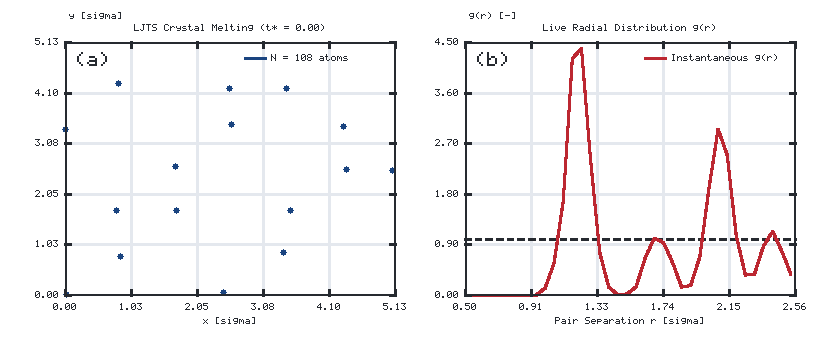

<sub><b>Left:</b> 2D projection of a 108-atom Lennard-Jones truncated-and-shifted (LJTS, $r_c = 2.5\sigma$) FCC crystal melting into a dense liquid at $\rho^* = 0.80$ under symplectic Velocity Verlet ($NVE$). <b>Right:</b> live evolution of the radial distribution function $g(r)$ from sharp crystalline Bragg peaks to damped liquid coordination shells. Generated by <code>scripts/make_readme_md_animation.py</code>.</sub>

</div>

---

Production molecular simulation codes such as LAMMPS are powerful research tools, yet students who jump straight to writing input decks rarely see *why* Velocity Verlet conserves a shadow Hamiltonian while explicit Euler diverges, *why* Berendsen rescaling suppresses canonical kinetic-energy variance while Bussi CSVR and BAOAB Langevin sample the exact Boltzmann distribution, *why* a single Nosé–Hoover thermostat fails ergodicity on a harmonic oscillator, or *how* microscopic autocorrelation functions yield macroscopic diffusion and shear viscosity. This book builds every core MD and Monte Carlo algorithm from scratch in pure Python and NumPy across **4 parts**, **16 executed chapter notebooks**, **16 executed solution notebooks**, and **48 graded exercises**.

> **Start in 60 seconds:** open [Chapter 1 — Pair potentials, reduced units, and periodic boundary conditions](notebooks/part1_nve_md/01_potentials_and_pbc.ipynb) or [Chapter 5 — Berendsen vs Bussi–Donadio–Parrinello (CSVR) thermostats](notebooks/part2_ensembles/05_berendsen_and_bussi_csvr.ipynb) directly on GitHub; every notebook is stored executed with its tables and figures rendered inline.

> **Status:** version 0.1.0. All 16 chapters are written, each with executed sample solutions.

---

## Why this book?

- **One algorithm per chapter, built from scratch.** Every method — minimum-image pair forces, Velocity Verlet, $O(N)$ linked-cell and Verlet neighbor lists, Bussi CSVR, BAOAB Langevin, Nosé–Hoover chains, Metropolis/Wolff Monte Carlo, Widom insertion, FFT Green–Kubo autocorrelation, and CABS polymer pore partitioning — is written transparently in plain NumPy before calling package helpers.
- **Every result is checked.** Every chapter verifies its numerical output (`assert np.allclose(...)`) against exact analytical statistical mechanics (Newton's Third Law, $O(\Delta t^2)$ shadow energy, $\chi^2_{\text{dof}}$ canonical variance, Onsager $T_c$, $B_2(T)$, Einstein–Green–Kubo parity, Casassa slit-pore series, and Yeh–Hummer $1/L$ scaling).
- **Pictures beside the theory.** Every chapter includes diagnostic multi-panel figures rendered inline next to the derivations.
- **Direct bridge to production LAMMPS.** Part II connects directly to thermostat benchmarking (`ljts-thermostats`), Chapter 15 connects to polymer confinement (`polyphys`, `cabs-partitioning`), and Chapter 16 generates matching LAMMPS input scripts (`pair_modify shift yes`, `temp/csvr`).
- **Honest about accuracy.** Each chapter documents truncation effects, timestep limits, non-ergodicity traps, and finite-size bias.

---

## What the checks show

<div align="center">
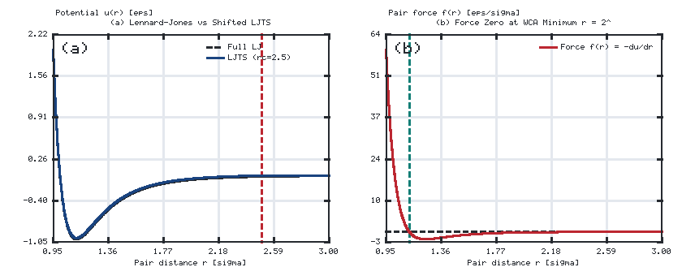
</div>

<sub><b>Figure 1.</b> Diagnostic verification from Chapter 1: <b>(a)</b> full Lennard-Jones vs truncated-and-shifted LJTS ($r_c = 2.5\sigma$), and <b>(b)</b> analytical pair force $f(r) = -du/dr$ crossing zero at the WCA minimum $r = 2^{1/6}\sigma$, verified against central finite differences to $<10^{-7}$.</sub>

<br>

| Check | Model (`engsim`) | Reference | Agreement |
| :--- | :--- | :--- | :--- |
| Ch 1 · LJTS pair force vs $-\nabla U$ | `lj_forces_all_pairs` | Central finite difference $-\Delta U/(2\epsilon)$ | $< 10^{-7}$ |
| Ch 1 · Newton's Third Law net force | $\lVert\sum_i \mathbf{f}_i\rVert_2$ on 108-atom FCC | Exact zero momentum conservation | $< 10^{-12}$ |
| Ch 2 · Velocity Verlet energy scaling | $\sigma_E(\Delta t)$ across $\Delta t \in [0.002, 0.008]$ | Theoretical $O(\Delta t^2)$ slope $= 2.00$ | $2.00 \pm 0.1$ |
| Ch 2 · Exact time-reversibility (50 steps) | `velocity_verlet_step` with $\mathbf{v}\to-\mathbf{v}$ | Initial coordinates $\mathbf{r}(0)$ | $< 10^{-10}$ |
| Ch 3 · $O(N)$ Linked-Cell vs $O(N^2)$ forces | `lj_forces_cell_list` ($N = 256$) | Exact `lj_forces_all_pairs` | $< 10^{-12}$ |
| Ch 3 · Verlet neighbor-list force parity | `VerletNeighborList.forces` ($r_s = 0.35$) | Exact `lj_forces_all_pairs` | $< 10^{-12}$ |
| Ch 4 · Equipartition & ideal-gas virial | `kinetic_energy_and_temp` & Clausius virial | $P = \rho T$ as $\rho \to 0$ | $< 5\%$ |
| Ch 5 · Canonical $NVT$ kinetic variance | `bussi_csvr_thermostat` vs `berendsen_thermostat` | Exact $\operatorname{Var}(K) = \frac{3N-3}{2}T^2$ | exact vs collapsed |
| Ch 6 · BAOAB Langevin harmonic variance | `baoab_langevin_step` at large $\Delta t = 0.25$ | Exact $\langle x^2 \rangle = k_B T / k = 1.0$ | $< 8\%$ |
| Ch 7 · Nosé–Hoover Chain-2 ergodicity | `nose_hoover_chain2_1d_step` on 1D HO | Exact Gaussian $\langle x^2 \rangle = 1, \langle x^4 \rangle = 3$ | restored |
| Ch 8 · Ideal-gas $NPT$ barostat EOS | `berendsen_barostat_scale` + CSVR | Exact $\langle \rho \rangle = P_0 / T_0 = 0.25$ | $< 10\%$ |
| Ch 9 · $O(N)$ MC $\Delta U$ vs full $O(N^2)$ | `lj_single_particle_energy` | Exact $U_{\text{after}} - U_{\text{before}}$ | $< 10^{-11}$ |
| Ch 10 · Ideal-gas Grand Canonical MC | $\mu VT$ insertion/deletion Markov chain | Exact Poisson $\operatorname{Var}(N) = \langle N \rangle = zV$ | $< 6\%$ |
| Ch 11 · 2D Ising phase transition | `ising_2d_wolff_step` & `ising_2d_metropolis_sweep` | Onsager $T_c = 2/\ln(1+\sqrt{2}) = 2.269185$ | exact $E_{\text{gs}}=-2J$ |
| Ch 12 · Widom insertion virial limit | `widom_excess_chemical_potential` | $\beta\mu_{\text{ex}} \to 2 B_2(T)\rho$ & Boyle $T_B^* \approx 3.42$ | verified |
| Ch 13 · Einstein MSD vs Green–Kubo VACF | `compute_msd` & `autocorrelation_fft` | Exact Langevin $C_v(t) = 3Te^{-\gamma t}, D = T/\gamma$ | $< 12\%$ |
| Ch 14 · Stress symmetry & RNEMD swaps | `lj_forces_all_pairs(..., return_stress=True)` | $S_{xy} = S_{yx}$ and exact momentum/KE swap | $< 10^{-12}$ |
| Ch 15 · Polymer chains & CABS partitioning | `sample_freely_jointed_chains` & `cabs_slit_partition_coefficient` | Exact $\langle R_e^2 \rangle = Nb^2$ & Casassa (1967) series | $< 5\%$ |
| Ch 16 · Yeh–Hummer $1/L$ finite-size scaling | `yeh_hummer_correction` linear fit + LAMMPS deck | Exact $D_\infty$ intercept & `pair_modify shift yes` | $< 10^{-12}$ |

---

## Gallery

| | |
| :---: | :---: |
| <br>Lennard-Jones vs shifted LJTS pair potential and WCA force zero ([Chapter 1](notebooks/part1_nve_md/01_potentials_and_pbc.ipynb)) | 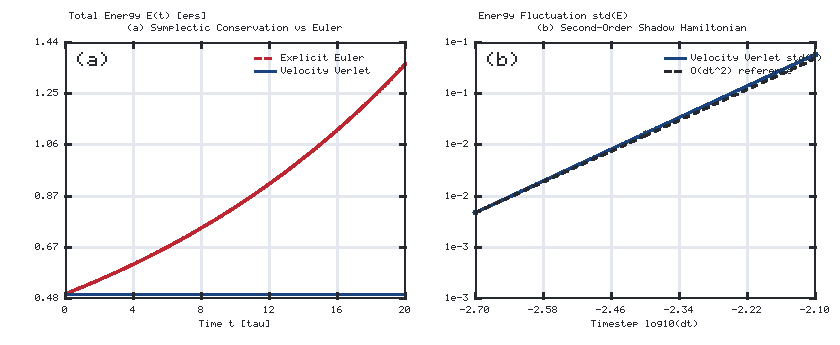<br>Symplectic Velocity Verlet vs Euler drift and $O(\Delta t^2)$ scaling ([Chapter 2](notebooks/part1_nve_md/02_velocity_verlet_integrators.ipynb)) |
| 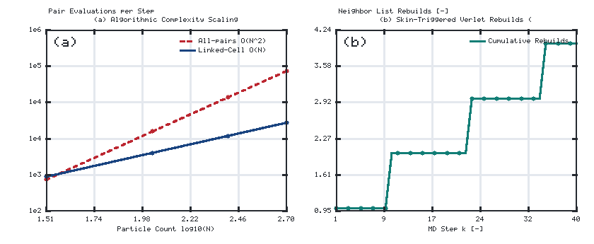<br>$O(N)$ Linked-Cell complexity scaling and skin-triggered Verlet rebuilds ([Chapter 3](notebooks/part1_nve_md/03_cell_and_verlet_lists.ipynb)) | 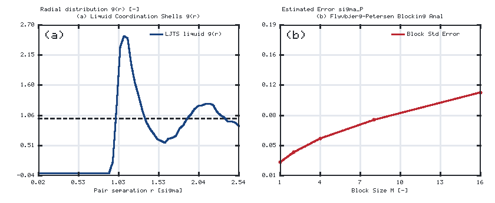<br>Liquid LJTS radial distribution function $g(r)$ and Flyvbjerg–Petersen block errors ([Chapter 4](notebooks/part1_nve_md/04_nve_rdf_and_virial_pressure.ipynb)) |
| 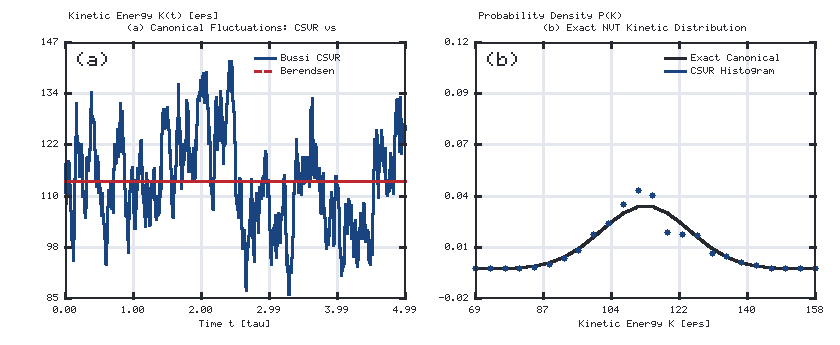<br>Bussi CSVR canonical kinetic fluctuations vs Berendsen variance collapse ([Chapter 5](notebooks/part2_ensembles/05_berendsen_and_bussi_csvr.ipynb)) | 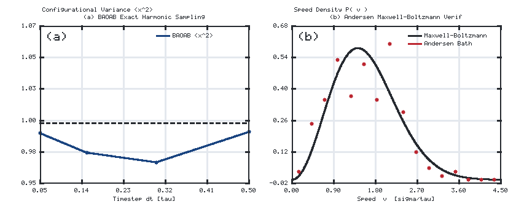<br>BAOAB exact harmonic variance at large $\Delta t$ and Andersen speed distribution ([Chapter 6](notebooks/part2_ensembles/06_andersen_and_langevin_baoab.ipynb)) |
| 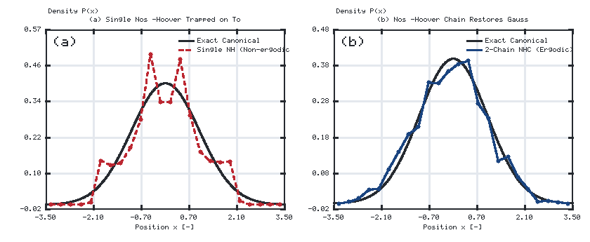<br>Single Nosé–Hoover non-ergodicity vs 2-chain NHC Gaussian recovery ([Chapter 7](notebooks/part2_ensembles/07_nose_hoover_and_chains.ipynb)) | 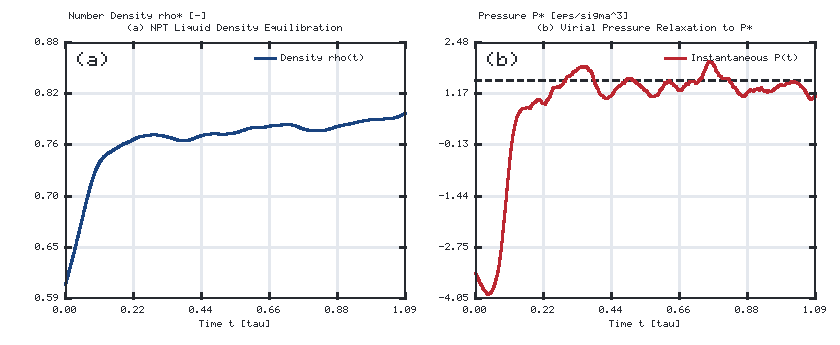<br>$NPT$ liquid density equilibration and virial pressure relaxation ([Chapter 8](notebooks/part2_ensembles/08_npt_barostats.ipynb)) |
| 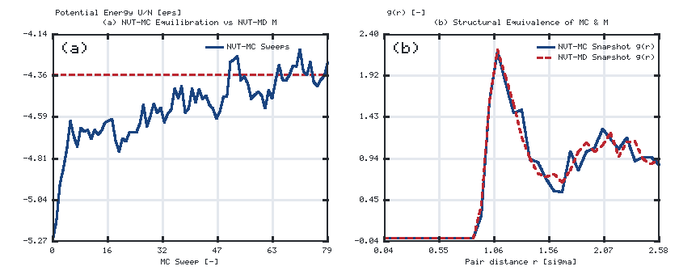<br>Metropolis $NVT$-MC energy equilibration and $g(r)$ equivalence with $NVT$-MD ([Chapter 9](notebooks/part3_monte_carlo/09_metropolis_nvt_mc.ipynb)) | 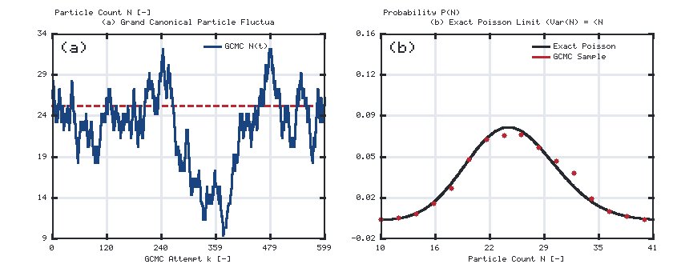<br>Grand Canonical ($\mu VT$) particle fluctuations matching the exact Poisson limit ([Chapter 10](notebooks/part3_monte_carlo/10_npt_and_grand_canonical_mc.ipynb)) |
| 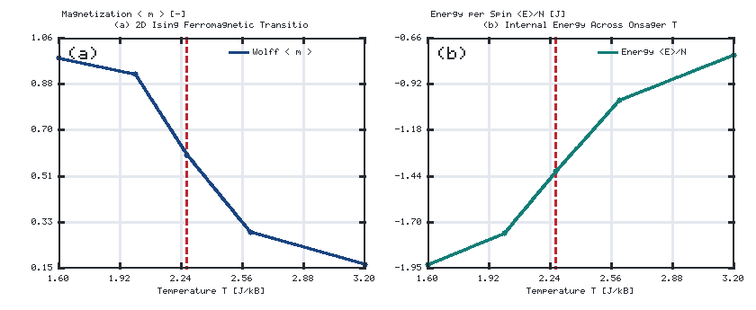<br>2D Ising ferromagnetic transition across Onsager's $T_c$ via Wolff clusters ([Chapter 11](notebooks/part3_monte_carlo/11_ising_metropolis_vs_wolff.ipynb)) | 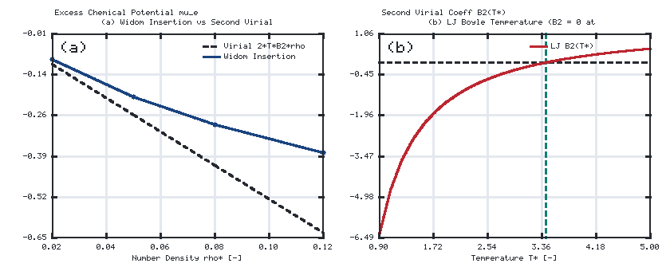<br>Widom test-particle insertion vs $2B_2(T)\rho$ and LJ Boyle temperature ([Chapter 12](notebooks/part3_monte_carlo/12_widom_and_free_energy.ipynb)) |
| 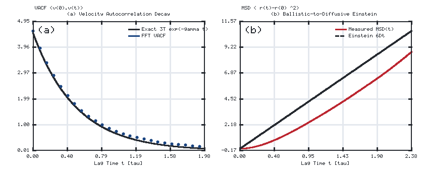<br>FFT velocity autocorrelation decay and ballistic-to-diffusive Einstein MSD ([Chapter 13](notebooks/part4_transport_lammps/13_diffusion_msd_and_green_kubo.ipynb)) | 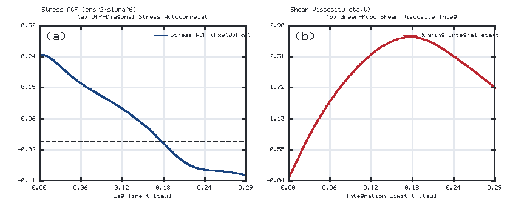<br>Off-diagonal stress ACF and Green–Kubo running shear viscosity integral ([Chapter 14](notebooks/part4_transport_lammps/14_viscosity_gk_and_rnemd.ipynb)) |
| 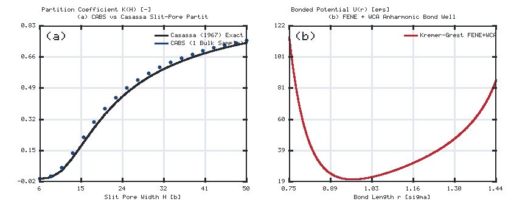<br>CABS slit-pore partition coefficients vs Casassa (1967) and FENE+WCA bond well ([Chapter 15](notebooks/part4_transport_lammps/15_polymers_fene_and_confinement.ipynb)) | 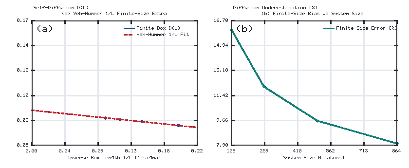<br>Yeh–Hummer $1/L$ finite-size diffusion extrapolation and system-size bias ([Chapter 16](notebooks/part4_transport_lammps/16_capstone_lammps_benchmark.ipynb)) |

---

## Installation

```bash
git clone https://github.com/ktwyw/engsim.git
cd engsim
pip install -e ".[book]"
jupyter lab
```

## Quick start

```python
import numpy as np
import engsim as es

rng = np.random.default_rng(2026)
pos, L = es.make_fcc_lattice(n_cells=3, rho=0.80)          # 108-atom FCC crystal
vel = es.init_velocities(len(pos), T_target=1.2, rng=rng)  # Maxwell-Boltzmann velocities
f_fn = lambda p, box: es.lj_forces_all_pairs(p, box, rc=2.5, shifted=True)
forces, u_pot, virial = f_fn(pos, L)

for _ in range(100):
    pos, vel, forces, u_pot, virial, _ = es.velocity_verlet_step(pos, vel, forces, 0.005, L, f_fn)
    vel = es.bussi_csvr_thermostat(vel, T_target=1.2, dt=0.005, tau_T=0.05, rng=rng)

ke, T_inst = es.kinetic_energy_and_temp(vel)
P_inst = 0.80 * T_inst + virial / (3.0 * L**3)
print(f"T* = {T_inst:.3f}, P* = {P_inst:.3f}, U/N = {u_pot/len(pos):.3f}")
```

---

## What's inside

### Part I · Foundations and microcanonical MD ($NVE$)

| Chapter | Topics | Checked against |
| :--- | :--- | :--- |
| [1. Pair potentials, reduced units, and periodic boundary conditions](notebooks/part1_nve_md/01_potentials_and_pbc.ipynb) | LJ 12–6, LJTS ($r_c=2.5$), Argon SI units, FCC crystal builder, PBC & minimum-image convention | Central finite-difference $-\nabla U$, Newton's Third Law, PBC invariance |
| [2. Time integration: Euler, Velocity Verlet, and symplectic shadow Hamiltonians](notebooks/part1_nve_md/02_velocity_verlet_integrators.ipynb) | Symplectic evolution, time-reversibility, $O(\Delta t^2)$ shadow Hamiltonian vs Euler energy drift | Exact $O(\Delta t^2)$ scaling, 50-step time reversal, harmonic shadow energy |
| [3. Scaling to $O(N)$: linked-cell lists and Verlet neighbor lists](notebooks/part1_nve_md/03_cell_and_verlet_lists.ipynb) | 3D 13-offset half-shell linked cells, Verlet skin $r_v = r_c + r_s$, displacement-triggered rebuilds | Exact bit-for-bit force, energy, and virial parity with $O(N^2)$ pair loop |
| [4. Structure and thermodynamics in $NVE$: equipartition, virial pressure, and $g(r)$](notebooks/part1_nve_md/04_nve_rdf_and_virial_pressure.ipynb) | Kinetic temperature, Clausius virial pressure, radial distribution function $g(r)$, Flyvbjerg–Petersen blocking | Ideal-gas $P=\rho T$ limit, liquid coordination number, white-noise block errors |

### Part II · Ensembles, thermostats, and barostats ($NVT$ & $NPT$)

| Chapter | Topics | Checked against |
| :--- | :--- | :--- |
| [5. Velocity rescaling, Berendsen, and Bussi–Donadio–Parrinello (CSVR) thermostats](notebooks/part2_ensembles/05_berendsen_and_bussi_csvr.ipynb) | Canonical $\chi^2_{\text{dof}}$ kinetic-energy distribution, Berendsen variance collapse, exact CSVR rescaling | Exact $\langle K \rangle$ and $\operatorname{Var}(K) = \frac{3N-3}{2}T^2$ |
| [6. Stochastic thermostats: Andersen and Langevin (BAOAB) dynamics](notebooks/part2_ensembles/06_andersen_and_langevin_baoab.ipynb) | Andersen collision bath, fluctuation–dissipation theorem, symmetric BAOAB Ornstein–Uhlenbeck splitting | Maxwell–Boltzmann speed density, BAOAB exact harmonic $\langle x^2 \rangle = k_BT/k$ |
| [7. Deterministic extended-system thermostats: Nosé–Hoover and Nosé–Hoover chains](notebooks/part2_ensembles/07_nose_hoover_and_chains.ipynb) | Extended friction variable $\zeta$, invariant tori non-ergodicity, 2-chain NHC operator splitting | Exact Gaussian moments $\langle x^2 \rangle = 1$, $\langle x^4 \rangle = 3$, kurtosis $= 0$ |
| [8. Constant-pressure simulation ($NPT$): Berendsen and isotropic barostats](notebooks/part2_ensembles/08_npt_barostats.ipynb) | Isotropic box scaling $L(t) = V(t)^{1/3}$, liquid-density equilibration, compressibility | Exact ideal-gas $NPT$ density $\rho = P_0 / T_0$ |

### Part III · Monte Carlo simulation and free energy

| Chapter | Topics | Checked against |
| :--- | :--- | :--- |
| [9. Metropolis Monte Carlo in the canonical ensemble ($NVT$-MC)](notebooks/part3_monte_carlo/09_metropolis_nvt_mc.ipynb) | Detailed balance, $O(N)$ single-particle $\Delta U$, step-size tuning, ergodic equivalence with $NVT$-MD | Exact $\Delta U$ vs full $O(N^2)$ recomputation, $\langle U/N \rangle$ and $g(r)$ parity with MD |
| [10. Isothermal–isobaric ($NPT$-MC) and grand canonical ($\mu VT$-MC) ensembles](notebooks/part3_monte_carlo/10_npt_and_grand_canonical_mc.ipynb) | Insertion/deletion acceptance probabilities, particle-number fluctuations, Langmuir adsorption | Exact ideal-gas Poisson distribution $\operatorname{Var}(N) = \langle N \rangle = zV$ |
| [11. Lattice models and phase transitions: 2D Ising (Metropolis vs Wolff cluster)](notebooks/part3_monte_carlo/11_ising_metropolis_vs_wolff.ipynb) | Checkerboard vectorized Metropolis, critical slowing down, Wolff single-cluster flips | Onsager $T_c = 2/\ln(1+\sqrt{2})$, ground state $E/N = -2J$, Metropolis/Wolff parity |
| [12. Free energy and chemical potential: Widom insertion and thermodynamic integration](notebooks/part3_monte_carlo/12_widom_and_free_energy.ipynb) | Ghost-particle insertion $\beta\mu_{\text{ex}} = -\ln\langle e^{-\beta\Delta U}\rangle$, second virial coefficient $B_2(T)$ | Exact low-density virial limit $2 B_2(T)\rho$ and LJ Boyle temperature $T_B^* \approx 3.42$ |

### Part IV · Transport, polymers, and bridging to LAMMPS

| Chapter | Topics | Checked against |
| :--- | :--- | :--- |
| [13. Self-diffusion: mean-squared displacement (Einstein) vs velocity autocorrelation (Green–Kubo)](notebooks/part4_transport_lammps/13_diffusion_msd_and_green_kubo.ipynb) | Unwrapped coordinates, ballistic $t^2$ vs diffusive $6Dt$ regimes, Wiener–Khinchin FFT VACF | Exact Langevin $C_v(t) = 3Te^{-\gamma t}$ and $D_{\text{MSD}} = D_{\text{GK}} = T/\gamma$ |
| [14. Shear viscosity via Green–Kubo stress autocorrelation and Müller–Plathe RNEMD](notebooks/part4_transport_lammps/14_viscosity_gk_and_rnemd.ipynb) | Microscopic virial stress tensor $P_{xy}(t)$, Green–Kubo viscosity integral, momentum-swapping RNEMD | Central-force stress symmetry $S_{xy}=S_{yx}$ and exact RNEMD momentum/KE conservation |
| [15. Polymer chains in simulation: Kremer–Grest FENE-WCA and CABS pore partitioning](notebooks/part4_transport_lammps/15_polymers_fene_and_confinement.ipynb) | FENE + WCA bead–spring chains, $\langle R_e^2 \rangle$, $\langle R_g^2 \rangle$, CABS slit-pore partitioning from one bulk sample | Exact $\langle R_e^2 \rangle = N b^2$, Casassa (1967) slit series, Brownian bridge $4/\sqrt{\pi}$ |
| [16. Capstone: validating your Python engine against LAMMPS and Yeh–Hummer $1/L$ scaling](notebooks/part4_transport_lammps/16_capstone_lammps_benchmark.ipynb) | LAMMPS `in.ljts` deck generation, cutoff/thermostat matching, Yeh–Hummer $1/L$ finite-size diffusion scaling | Exact $1/L$ extrapolation to $D_\infty$, Argon SI diffusion conversion |

Sample solutions: [Chapter 1](solutions/part1_nve_md/01_solutions.ipynb) · [2](solutions/part1_nve_md/02_solutions.ipynb) · [3](solutions/part1_nve_md/03_solutions.ipynb) · [4](solutions/part1_nve_md/04_solutions.ipynb) · [5](solutions/part2_ensembles/05_solutions.ipynb) · [6](solutions/part2_ensembles/06_solutions.ipynb) · [7](solutions/part2_ensembles/07_solutions.ipynb) · [8](solutions/part2_ensembles/08_solutions.ipynb) · [9](solutions/part3_monte_carlo/09_solutions.ipynb) · [10](solutions/part3_monte_carlo/10_solutions.ipynb) · [11](solutions/part3_monte_carlo/11_solutions.ipynb) · [12](solutions/part3_monte_carlo/12_solutions.ipynb) · [13](solutions/part4_transport_lammps/13_solutions.ipynb) · [14](solutions/part4_transport_lammps/14_solutions.ipynb) · [15](solutions/part4_transport_lammps/15_solutions.ipynb) · [16](solutions/part4_transport_lammps/16_solutions.ipynb)

---

## The `engsim` package

| Module | Purpose |
| :--- | :--- |
| `engsim.units` | Reduced LJ units $\leftrightarrow$ SI conversions (`LJUnitSystem`, `ARGON`, `METHANE`, `KRYPTON`) |
| `engsim.lattices` | 3D crystal builders (`make_fcc_lattice`, `make_sc_lattice`) and zero-COM Maxwell–Boltzmann `init_velocities` |
| `engsim.potentials` | `wrap_positions`, `minimum_image`, `lj_forces_all_pairs` (with optional $3\times 3$ stress tensor), `lj_single_particle_energy`, and `lj_tail_corrections` |
| `engsim.neighbors` | $O(N)$ 3D linked-cell list (`build_cell_list`, `lj_forces_cell_list`) and displacement-triggered `VerletNeighborList` |
| `engsim.integrators` | `velocity_verlet_step`, `berendsen_thermostat`, `bussi_csvr_thermostat`, `andersen_thermostat`, `baoab_langevin_step`, `nose_hoover_1d_step`, `nose_hoover_chain2_1d_step`, and `berendsen_barostat_scale` |
| `engsim.analysis` | `compute_rdf`, `compute_msd`, Wiener–Khinchin `autocorrelation_fft`, `green_kubo_integral`, and `flyvbjerg_petersen_block_errors` |
| `engsim.montecarlo` | `run_nvt_mc`, `widom_excess_chemical_potential`, `ising_2d_energy_mag`, `ising_2d_metropolis_sweep`, and `ising_2d_wolff_step` |
| `engsim.polymers` | `fene_bond_forces`, `radius_of_gyration_sq`, `sample_freely_jointed_chains`, and `cabs_slit_partition_coefficient` |
| `engsim.plotting` | Shared publication Matplotlib style (`use_style`) and `panel_label` |
| `engsim.reference` | Exact analytical benchmarks (`ONSAGER_TC_2D_ISING`, `second_virial_lj_numerical`, `canonical_ke_variance_exact`, `langevin_vacf_exact`, `casassa_slit_partition_exact`, `yeh_hummer_correction`) |

Run the test suite with `pytest -q`.

---

## Companion books & research repositories

- [`ljts-thermostats`](https://github.com/ktwyw/ljts-thermostats) — Replicated, finite-size- and timestep-controlled thermostat benchmark of the Lennard-Jones liquid in LAMMPS.
- [`polyphys`](https://github.com/ktwyw/polyphys) & [`cabs-partitioning`](https://github.com/ktwyw/cabs-partitioning) — Elementary polymer physics and equilibrium pore partitioning by the CABS method.
- [`computational-materials-software`](https://github.com/ktwyw/computational-materials-software) — Curated directory of electronic structure, MD, MC, and continuum simulation software.
- [`engthermo`](https://github.com/ktwyw/engthermo), [`engstoch`](https://github.com/ktwyw/engstoch), [`engtransport`](https://github.com/ktwyw/engtransport), [`engprocess`](https://github.com/ktwyw/engprocess), and [`onsager-variational-methods`](https://github.com/ktwyw/onsager-variational-methods).

## Author, Citing & License

**Yanwei Wang** — School of Engineering and Digital Sciences, Nazarbayev University, Astana, Kazakhstan ([ORCID: 0000-0002-8488-9833](https://orcid.org/0000-0002-8488-9833)). Cite via [`CITATION.cff`](CITATION.cff). Code is licensed under [MIT](LICENSE); text, figures, and executed notebook outputs under [CC BY 4.0](DATA_LICENSE.md).
